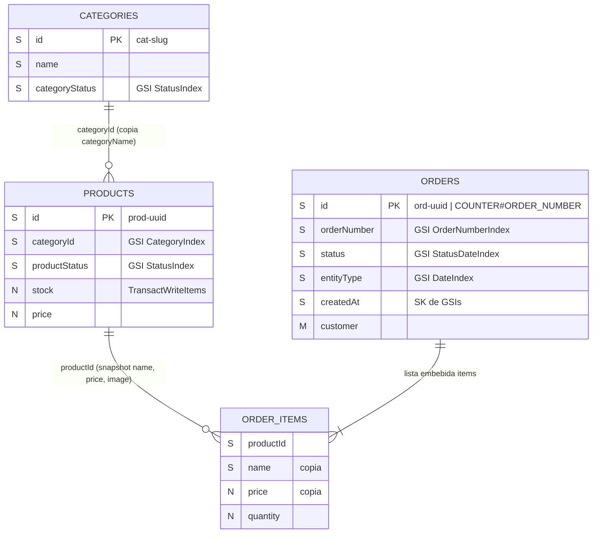

# Diseño de Base de Datos — CloudStore Serverless (Amazon DynamoDB)

> **Versión:** 1.1 (aprobado)
> **Fecha:** 2026-11-09
> **Fuentes analizadas:** `API-CONTRACT.md`, `frontend/js/api.js`, `frontend/js/mock-data.js`, `frontend/admin/product-form.html`, `frontend/js/orders.js`
> **Estado:** Diseño aprobado y alineado con `API-CONTRACT.md`. **No se ha creado ningún recurso en AWS.**

---

## 1. Decisiones generales

| Decisión | Elección | Motivo |
|---|---|---|
| Modelo | **3 tablas** (una por entidad) | Requisito del proyecto. Más fácil de explicar y de mapear 1:1 con `API-CONTRACT.md` que un diseño de tabla única. |
| Modo de capacidad | **On-Demand** (`PAY_PER_REQUEST`) | Tráfico bajo e impredecible; sin tener que planear capacidad. |
| Identificadores | `prod-<uuid>`, `cat-<slug>`, `ord-<uuid>` | Únicos sin coordinación. Se conservan los prefijos actuales y los IDs de los datos semilla (`prod-001`, `ord-1001`). |
| Fechas | Cadena ISO 8601 UTC (`2026-03-01T15:30:00Z`) | Se ordenan bien lexicográficamente → sirven como Sort Key. |
| Dinero | Number (`N`) con 2 decimales | DynamoDB guarda los números como decimales exactos (hasta 38 dígitos). El redondeo se controla en la Lambda. |
| Listas | `L` (List), no `SS` (String Set) | `features` e `items` necesitan orden y pueden estar vacíos; un `SS` no puede estar vacío y no tiene orden. |
| Atributos opcionales vacíos | **Se omite el atributo** (no se guarda `null`) | Simplifica los índices dispersos (*sparse*) y el `FilterExpression`. La Lambda devuelve `null` en el JSON cuando falta. |
| Información de pago | **No se almacena** | No hay pagos en línea. |

### Restricción clave de DynamoDB que condiciona el diseño

Las claves de tabla y de GSI **solo pueden ser String, Number o Binary — nunca Boolean**.
El contrato usa `active: true|false`, así que se agrega un atributo **derivado** de tipo String (`productStatus` / `categoryStatus` = `"ACTIVE"` | `"INACTIVE"`) que la Lambda mantiene sincronizado con `active`. El JSON público del contrato **no cambia**.

---

## 2. Tabla `CloudStore-Products`

### 2.1 Claves

| Elemento | Atributo | Tipo |
|---|---|---|
| Partition Key | `id` | S |
| Sort Key | — | — |

**¿Por qué solo `id`?** La operación más común es `GET /products/{id}` (detalle, agregar al carrito, decremento de stock). Un `GetItem` por `id` es el acceso más rápido y barato. No hay ninguna relación uno-a-muchos dentro de un mismo producto que justifique una Sort Key.

### 2.2 Atributos

| Atributo | Tipo DynamoDB | Req. | Origen | Notas |
|---|---|---|---|---|
| `id` | S | ✅ | Lambda | `prod-<uuid>`. **Referencia única principal del producto** |
| `name` | S | ✅ | Cliente | |
| `slug` | S | ✅ | Lambda | Generado desde `name` si no viene. No requiere unicidad (el frontend navega por `id`) |
| `categoryId` | S | ✅ | Cliente | Clave del GSI `CategoryIndex` |
| `categoryName` | S | ✅ | Cliente | **Desnormalizado** (copia) para no consultar Categories en cada listado |
| `description` | S | ✅ | Cliente | |
| `features` | L (de S) | — | Cliente | Default `[]` |
| `price` | N | ✅ | Cliente | > 0 |
| `comparePrice` | N | — | Cliente | Se omite si no hay descuento |
| `stock` | N | ✅ | Cliente | Entero ≥ 0. Se decrementa con transacción |
| `image` | S | ✅ | Cliente | URL (futuro: S3/CloudFront) |
| `featured` | BOOL | — | Cliente | Default `false` |
| `active` | BOOL | ✅ | Cliente | Campo del contrato |
| `productStatus` | S | ✅ | **Lambda (derivado)** | `"ACTIVE"` / `"INACTIVE"`. Clave del GSI `StatusIndex` |
| `categorySort` | S | ✅ | **Lambda (derivado)** | `"<productStatus>#<createdAt>"`. Sort Key del GSI `CategoryIndex` |
| `rating` | N | ✅ | Lambda | Default `5.0` |
| `reviewsCount` | N | ✅ | Lambda | Default `0` |
| `createdAt` | S | ✅ | Lambda | ISO 8601 |
| `updatedAt` | S | — | Lambda | ISO 8601 |

> `productStatus` y `categorySort` son internos: la Lambda los quita antes de responder, para que el JSON siga igual al de `API-CONTRACT.md`.

### 2.3 Índices secundarios globales

| GSI | Partition Key | Sort Key | Proyección | Uso |
|---|---|---|---|---|
| `StatusIndex` | `productStatus` (S) | `createdAt` (S) | ALL | Catálogo de activos ordenado por fecha; vista admin |
| `CategoryIndex` | `categoryId` (S) | `categorySort` (S) | ALL | Productos de una categoría (solo activos o todos) |

**Por qué `StatusIndex`:** "consultar todos los productos activos" es la consulta principal de la tienda. Sin este índice sería un `Scan` + filtro. Con él es un `Query` sobre la partición `ACTIVE`, ya ordenado por `createdAt` (el orden por defecto `newest` de `api.js`).

**Por qué `CategoryIndex` con Sort Key compuesta:** con `categorySort = "ACTIVE#2026-01-15T10:00:00Z"`, un solo `Query` resuelve a la vez "categoría X" + "solo activos" + "ordenado por fecha" usando `begins_with(categorySort, "ACTIVE#")`. Sin el prefijo `begins_with`, devuelve todos los productos de la categoría (lo que necesita la vista admin y la validación al borrar una categoría).

**Proyección ALL:** las tarjetas del catálogo usan casi todos los atributos. Con `KEYS_ONLY` habría que hacer un `GetItem` extra por cada producto. Con un catálogo pequeño, el costo extra de almacenamiento es despreciable.

### 2.4 Patrones de acceso

| # | Necesidad | Endpoint | Operación DynamoDB |
|---|---|---|---|
| P1 | Productos activos | `GET /products` | `Query StatusIndex` · `productStatus = "ACTIVE"` · `ScanIndexForward=false` |
| P2 | Activos destacados | `GET /products?onlyFeatured=true` | P1 + `FilterExpression featured = true` |
| P3 | Activos por categoría | `GET /products?categoryId=X` | `Query CategoryIndex` · `categoryId = X AND begins_with(categorySort, "ACTIVE#")` |
| P4 | Todos (admin) | `GET /products?includeInactive=true` | 2 × `Query StatusIndex` (`ACTIVE` + `INACTIVE`) y unir resultados |
| P5 | Todos de una categoría (admin) | `GET /products?includeInactive=true&categoryId=X` | `Query CategoryIndex` · `categoryId = X` |
| P6 | Producto por ID | `GET /products/{id}` | `GetItem` · `id` |
| P7 | Crear | `POST /products` | `PutItem` · `ConditionExpression attribute_not_exists(id)` |
| P8 | Actualizar | `PUT /products/{id}` | `UpdateItem` · `ConditionExpression attribute_exists(id)` · recalcular campos derivados si cambian `active`/`categoryId` |
| P9 | Desactivar | `PUT /products/{id}` `{active:false}` | Igual que P8 → `productStatus = "INACTIVE"` (el producto pasa automáticamente a la otra partición del GSI) |
| P10 | Eliminar | `DELETE /products/{id}` | `DeleteItem` · `ConditionExpression attribute_exists(id)` |
| P11 | Inventario de un producto | (interno / detalle) | `GetItem` · `ProjectionExpression id, name, stock, productStatus` |
| P12 | Stock bajo (dashboard) | `GET /dashboard/metrics` | `Query StatusIndex` `ACTIVE` · `FilterExpression stock <= :5` |
| P13 | ¿Categoría tiene productos? | `DELETE /categories/{id}` | `Query CategoryIndex` · `categoryId = X` · `Limit 1` |

**Búsqueda por texto y orden por precio/nombre** (`search`, `sort=price-asc`, etc.): DynamoDB no tiene búsqueda de texto completo ni puede ordenar por un atributo que no sea la Sort Key. La Lambda resuelve P1/P3 y luego **filtra y ordena en memoria**. Con decenas o cientos de productos es eficiente. Si el catálogo crece a miles, la vía recomendada es Amazon OpenSearch (fuera de alcance).

### 2.5 Ejemplo de documento

```json
{
  "id": "prod-001",
  "name": "MacBook Pro 16\" M3 Max",
  "slug": "macbook-pro-16-m3-max",
  "categoryId": "cat-laptops",
  "categoryName": "Laptops & Computadoras",
  "description": "La estación de trabajo portátil definitiva para desarrollo de software...",
  "features": [
    "Chip Apple M3 Max (16 CPU / 40 GPU)",
    "36 GB de memoria unificada"
  ],
  "price": 3499.00,
  "comparePrice": 3899.00,
  "stock": 8,
  "image": "https://images.unsplash.com/photo-1517336714731-489689fd1ca8?auto=format&fit=crop&w=800&q=80",
  "featured": true,
  "active": true,
  "productStatus": "ACTIVE",
  "categorySort": "ACTIVE#2026-01-15T10:00:00Z",
  "rating": 4.9,
  "reviewsCount": 38,
  "createdAt": "2026-01-15T10:00:00Z"
}
```

Producto inactivo (después de `PUT {active:false}`):

```json
{
  "id": "prod-008",
  "active": false,
  "productStatus": "INACTIVE",
  "categorySort": "INACTIVE#2026-02-18T12:00:00Z",
  "updatedAt": "2026-11-08T23:00:00Z"
}
```

---

## 3. Tabla `CloudStore-Categories`

### 3.1 Claves

| Elemento | Atributo | Tipo |
|---|---|---|
| Partition Key | `id` | S |
| Sort Key | — | — |

**¿Por qué `id = "cat-" + slug`?** Es la convención que ya usa `api.js` (`'cat-' + catData.slug`). Así el slug queda **garantizado como único por la propia clave primaria**: un `PutItem` con `attribute_not_exists(id)` falla si el slug ya existe, lo que permite devolver el `409` del contrato **de forma atómica**, sin índice adicional.

### 3.2 Atributos

| Atributo | Tipo | Req. | Origen | Notas |
|---|---|---|---|---|
| `id` | S | ✅ | Lambda | `cat-<slug>` |
| `name` | S | ✅ | Cliente | Sort Key del GSI |
| `slug` | S | ✅ | Cliente | Inmutable después de crear (forma parte del `id`) |
| `description` | S | — | Cliente | |
| `icon` | S | — | Cliente | Clase Bootstrap Icons, default `bi-tag` |
| `active` | BOOL | ✅ | Cliente | Campo del contrato |
| `categoryStatus` | S | ✅ | **Lambda (derivado)** | `"ACTIVE"` / `"INACTIVE"` |
| `createdAt` | S | ✅ | Lambda | |
| `updatedAt` | S | — | Lambda | |

> `productCount` **no se almacena**: se calcula al consultar (ver §6, punto 6).

### 3.3 Índices secundarios globales

| GSI | Partition Key | Sort Key | Proyección | Uso |
|---|---|---|---|---|
| `StatusIndex` | `categoryStatus` (S) | `name` (S) | ALL | Categorías por estado (`ACTIVE` / `INACTIVE`) ordenadas alfabéticamente |

**Por qué se conserva `StatusIndex`:** permite consultar las categorías activas (comportamiento por defecto de `GET /categories`) o todas las categorías (`GET /categories?includeInactive=true`) mediante `Query` sin recurrir a `Scan`, entregando los resultados ya ordenados alfabéticamente por `name` y manteniendo el mismo patrón arquitectónico que `CloudStore-Products`.

### 3.4 Patrones de acceso

| # | Necesidad | Endpoint | Operación DynamoDB |
|---|---|---|---|
| C1 | Categorías activas (por defecto, tienda) | `GET /categories` | `Query StatusIndex` · `categoryStatus = "ACTIVE"` |
| C2 | Todas las categorías (admin) | `GET /categories?includeInactive=true` | 2 × `Query StatusIndex` (`ACTIVE` + `INACTIVE`) |
| C3 | Por ID | (interno) | `GetItem` · `id` |
| C4 | Crear | `POST /categories` | `PutItem` · `attribute_not_exists(id)` → `409` si el slug existe |
| C5 | Actualizar | `PUT /categories/{id}` | `UpdateItem` · `attribute_exists(id)` |
| C6 | Desactivar | `PUT /categories/{id}` `{active:false}` | `UpdateItem` → `categoryStatus = "INACTIVE"` |
| C7 | Eliminar | `DELETE /categories/{id}` | P13 (¿tiene productos?) → si no, `DeleteItem` |

### 3.5 Ejemplo de documento

```json
{
  "id": "cat-laptops",
  "name": "Laptops & Computadoras",
  "slug": "laptops-computadoras",
  "description": "Equipos portátiles y estaciones de trabajo de alto rendimiento para desarrolladores y creadores.",
  "icon": "bi-laptop",
  "active": true,
  "categoryStatus": "ACTIVE",
  "createdAt": "2026-01-01T00:00:00Z"
}
```

---

## 4. Tabla `CloudStore-Orders`

### 4.1 Claves

| Elemento | Atributo | Tipo |
|---|---|---|
| Partition Key | `id` | S |
| Sort Key | — | — |

**¿Por qué no `items` como elementos separados (PK=`orderId`, SK=`ITEM#...`)?** Un pedido siempre se lee y se escribe completo, nunca se consulta un artículo suelto, y el carrito tiene pocos artículos (muy lejos del límite de 400 KB por ítem). Guardar `items` como una lista embebida permite leer el pedido con un solo `GetItem` y escribirlo con un solo `Put` dentro de la transacción.

### 4.2 Atributos

| Atributo | Tipo | Req. | Origen | Notas |
|---|---|---|---|---|
| `id` | S | ✅ | Lambda | `ord-<uuid>` |
| `orderNumber` | S | ✅ | Lambda | `CS-<año>-<consecutivo>`, desde contador atómico (§4.6) |
| `entityType` | S | ✅ | **Lambda (constante)** | `"ORDER"`. Partition Key del GSI `DateIndex` |
| `customer` | M | ✅ | Cliente | `{ name, phone, email?, address, notes? }` |
| `items` | L (de M) | ✅ | **Lambda** (con datos del cliente validados) | Snapshot: `{ productId, name, price, quantity, subtotal, image }` |
| `subtotal` | N | ✅ | **Lambda (recalculado)** | Suma de `items[].subtotal` |
| `shipping` | N | ✅ | **Lambda (recalculado)** | `0` si `subtotal >= 500` |
| `total` | N | ✅ | **Lambda (recalculado)** | `subtotal + shipping` |
| `status` | S | ✅ | Lambda | `pendiente` \| `confirmado` \| `enviado` \| `cancelado` |
| `trackingNumber` | S | — | Admin | Se omite si está vacío |
| `whatsappSent` | BOOL | ✅ | Lambda | Default `false` |
| `createdAt` | S | ✅ | Lambda | Sort Key de los GSIs |
| `updatedAt` | S | — | Lambda | |

#### Snapshot, consistencia de precios y regla explícita de envío (requisitos)

- **Copia inmutable (snapshot):** Cada elemento de `items` guarda una copia de `name`, `price` e `image` **tal como estaban en DynamoDB al momento de la compra**. Si después el producto cambia de precio, se renombra o se elimina, el pedido histórico conserva los valores originales.
- **Comparación estricta de precio y recálculo en el backend:** La Lambda exige que cada artículo de `items` incluya el `price` que el cliente vio al confirmar el pedido y lo compara contra el `price` actual en `CloudStore-Products` (`BatchGetItem` con `ConsistentRead: true`). Si el precio enviado difiere del precio actual en DynamoDB (`|clientPrice - dbPrice| > 0.001`), o si el precio cambia entre la lectura y el `TransactWriteItems` (`ConditionExpression: price = :snapshotPrice`), **se devuelve `HTTP 409 Conflict` sin registrar el pedido** para que el cliente revise el precio actualizado y confirme nuevamente.
- **Regla explícita de cálculo de `shipping` (`CONFIG.SHIPPING`, en pesos mexicanos `MXN`):**
  - `FREE_THRESHOLD = 500.00` (`MXN`) — Envío gratis desde `$500.00 MXN`
  - `STANDARD_COST = 20.00` (`MXN`) — Envío estándar de `$20.00 MXN`
  - Si `subtotal <= 0` → `shipping = 0.00`
  - Si `subtotal >= 500.00` → `shipping = 0.00` (Envío gratis)
  - Si `0 < subtotal < 500.00` → `shipping = 20.00` (Envío estándar)
  - `total = round(subtotal + shipping, 2)`
  Esta misma regla se aplica en `config.js`, `cart.js`, `api.js` (modo Mock) y en la Lambda de `POST /orders`.

### 4.3 Índices secundarios globales

| GSI | Partition Key | Sort Key | Proyección | Uso |
|---|---|---|---|---|
| `StatusDateIndex` | `status` (S) | `createdAt` (S) | ALL | Pedidos de un estado, ordenados por fecha |
| `DateIndex` | `entityType` (S) | `createdAt` (S) | ALL | Todos los pedidos ordenados por fecha |
| `OrderNumberIndex` | `orderNumber` (S) | — | ALL | Buscar por folio (`CS-2026-1001`) |

**Por qué `StatusDateIndex`:** cubre dos requisitos con un solo `Query` — "filtrar por estado" y "ordenar por fecha". Cuando el admin cambia el estado, DynamoDB mueve el pedido automáticamente a la partición correcta del índice.

**Por qué `DateIndex` con partición constante (`entityType = "ORDER"`):** DynamoDB solo ordena resultados *dentro* de una misma Partition Key. Para listar **todos** los pedidos ordenados por fecha (`createdAt`) mediante `Query` sin usar `Scan`, todos los pedidos comparten el atributo constante `entityType = "ORDER"`.
> **Consideración de escalabilidad (educativo vs. producción):** Una clave de partición constante concentra todas las escrituras del índice en una sola partición física (límite aproximado de 1,000 WCU/s y 3,000 RCU/s por partición). Este diseño es **totalmente adecuado para el volumen educativo y de una tienda mediana**. En un entorno de **producción de alto tráfico**, se debe reemplazar o complementar con **particionamiento por periodo temporal** (por ejemplo, `orderMonth = "2026-11"` como Partition Key del GSI y consultar mes por mes) o **write sharding** (`entityType = "ORDER#" + (hash % N)`).

**Por qué `OrderNumberIndex`:** `GET /orders/{id}` acepta el ID interno **o** el folio (así funciona `getOrderById()` hoy, y `order-success.html` lo aprovecha). Si el parámetro empieza con `CS-`, la Lambda consulta este índice; si empieza con `ord-`, hace `GetItem`.

### 4.4 Patrones de acceso

| # | Necesidad | Endpoint | Operación DynamoDB |
|---|---|---|---|
| O1 | Crear pedido (atómico) | `POST /orders` | `BatchGetItem (ConsistentRead)` productos + `GetItem (ConsistentRead)` contador → `TransactWriteItems` (§4.5) |
| O2 | Pedido por ID | `GET /orders/ord-…` | `GetItem` · `id` |
| O3 | Pedido por folio | `GET /orders/CS-…` | `Query OrderNumberIndex` · `orderNumber = X` · `Limit 1` |
| O4 | Listar todos por fecha | `GET /orders` / `?status=all` | `Query DateIndex` · `entityType = "ORDER"` · `ScanIndexForward=false` |
| O5 | Filtrar por estado | `GET /orders?status=pendiente` | `Query StatusDateIndex` · `status = X` · `ScanIndexForward=false` |
| O6 | Buscar por cliente/teléfono/folio | `GET /orders?search=…` | O4 u O5 + filtrado en la Lambda (§6.7) |
| O7 | Actualizar estado | `PATCH /orders/{id}/status` | `UpdateItem` · `SET #status = :s, updatedAt = :now [, trackingNumber = :t]` · `ConditionExpression attribute_exists(id)` |
| O8 | Pedidos recientes (dashboard) | `GET /dashboard/metrics` | O4 con `Limit 5` |

### 4.5 Creación atómica del pedido con `TransactWriteItems`

La creación de un pedido (`POST /orders`) ejecuta **en una sola transacción `TransactWriteItems`** tres operaciones indivisibles:
1. **Actualizar condicionalmente el contador de folios** (`id = "COUNTER#ORDER_NUMBER"` en `CloudStore-Orders`), comprobando que conserva el valor leído.
2. **Insertar el pedido** (`Put` en `CloudStore-Orders`) con el folio calculado, el snapshot de productos y los totales recalculados.
3. **Descontar el inventario** (`Update` en `CloudStore-Products`) de cada producto único, comprobando que sigue activo, conserva el precio leído y tiene stock suficiente.

> **Garantía de integridad:** Nunca se permite registrar un pedido sin haber incrementado el contador dentro de la misma transacción, ni se permiten folios duplicados.

#### 1. Agrupación previa y límites de la transacción

- **Una sola operación por elemento:** DynamoDB rechaza cualquier `TransactWriteItems` que incluya más de una operación sobre la misma clave primaria (`ValidationException: Transaction request cannot include multiple operations on one item`). Por ello, antes de consultar DynamoDB o armar la transacción, la Lambda **agrupa los artículos repetidos del carrito por `productId`**, sumando sus cantidades (`quantity`).
- **Límite duro de DynamoDB (`100` acciones por `TransactWriteItems`):** Cada pedido consume $2 + N$ acciones en la transacción:
  - Acción `0`: `Update` en `CloudStore-Orders` (`id = "COUNTER#ORDER_NUMBER"`).
  - Acción `1`: `Put` en `CloudStore-Orders` (`id = "ord-<uuid>"`).
  - Acciones `2..N+1`: $N$ operaciones `Update` en `CloudStore-Products` (una por cada `productId` único).
- **Límite de negocio por pedido (`MAX_DISTINCT_ITEMS = 50`):** Se establece un máximo razonable de **50 productos distintos por pedido** (tras agrupar por `productId`), verificando además que $2 + N \le 100$. Si un carrito supera los 50 productos distintos, se devuelve `HTTP 400 Bad Request` antes de invocar a DynamoDB.

#### 2. Algoritmo paso a paso en la Lambda

1. **Validar entrada y agrupar por `productId`:**
   - Verificar `customer.name`, `customer.phone`, `customer.address` y que `items` no esté vacío.
   - Consolidar ítems repetidos por `productId` sumando `quantity` (entero $\ge 1$).
   - Comprobar que `groupedItems.size <= 50` y `2 + groupedItems.size <= 100`.
2. **Lectura consistente de productos (`BatchGetItem` con `ConsistentRead: true`):**
   - Leer `id`, `name`, `price`, `image`, `stock`, `active` y `productStatus` en `CloudStore-Products` para los $N$ productos únicos.
   - Si algún producto no existe, `active != true` o `productStatus != "ACTIVE"` → cancelar y devolver `HTTP 409 Conflict` (`"El producto {id} no está disponible o fue desactivado"`).
   - Si el cliente envió `items[].price` y difiere del `price` actual en DynamoDB → cancelar y devolver `HTTP 409 Conflict` (`"El precio del producto '{name}' ({id}) cambió recientemente. Por favor actualiza tu carrito e intenta nuevamente."`).
   - Si `stock < quantity` → cancelar y devolver `HTTP 409 Conflict` (`"Stock insuficiente para el producto {id}. Disponible: {stock}"`).
3. **Construir snapshot de ítems y recalcular totales:**
   - Para cada producto único, fijar `snapshotPrice = product.price`, `name = product.name`, `image = product.image` y `itemSubtotal = round(snapshotPrice * quantity, 2)`.
   - Calcular `subtotal = round(Σ itemSubtotal, 2)`.
   - Aplicar la regla explícita de envío: `shipping = (subtotal >= 500.00 ? 0.00 : 20.00)`.
   - Calcular `total = round(subtotal + shipping, 2)`.
4. **Ciclo de lectura consistente del contador y ejecución de `TransactWriteItems` (máximo `MAX_CONCURRENCY_RETRIES = 3` intentos):**
   - **Paso 4a — Lectura consistente del contador:**
     ```text
     GetItem CloudStore-Orders
       Key: { id: "COUNTER#ORDER_NUMBER" }
       ConsistentRead: true
     ```
     Si el elemento existe, `currentSeq = item.seq`; si aún no existe en la tabla, `currentSeq = 1005` (valor semilla tras `CS-2026-1001`..`1005`).
   - **Paso 4b — Cálculo del siguiente folio:**
     `nextSeq = currentSeq + 1` → `orderNumber = "CS-2026-" + nextSeq`.
   - **Paso 4c — Ejecución atómica de `TransactWriteItems`:**

```text
TransactWriteItems [
  # Acción [0]: Actualización condicional del contador comprobando que conserva el valor leído
  Update CloudStore-Orders
    Key: { id: "COUNTER#ORDER_NUMBER" }
    UpdateExpression:    SET seq = :nextSeq, updatedAt = :now
    ConditionExpression: (attribute_not_exists(seq) AND :currentSeq = :seedSeq)
                         OR seq = :currentSeq

  # Acción [1]: Inserción del pedido con el folio calculado y el snapshot de productos
  Put CloudStore-Orders
    Item: {
      id: "ord-<uuid>",
      orderNumber: "CS-2026-1006",
      entityType: "ORDER",
      customer: { name, phone, email, address, notes },
      items: [ { productId, name, price, quantity, subtotal, image }, ... ],
      subtotal: 798.00,
      shipping: 0.00,
      total: 798.00,
      status: "pendiente",
      whatsappSent: false,
      createdAt: :now
    }
    ConditionExpression: attribute_not_exists(id)

  # Acciones [2..N+1]: 1 Update por cada producto único comprobando activo, precio y stock
  Update CloudStore-Products
    Key: { id: "prod-003" }
    UpdateExpression:    SET stock = stock - :qty, updatedAt = :now
    ConditionExpression: attribute_exists(id)
                         AND active = :true
                         AND productStatus = :active
                         AND price = :snapshotPrice
                         AND stock >= :qty

  ... (un Update por cada productId único)
]
```

#### 3. Clasificación y manejo de errores de cancelación y concurrencia

Cuando `TransactWriteItems` lanza `TransactionCanceledException`, DynamoDB devuelve el arreglo `CancellationReasons` con exactamente $2 + N$ posiciones (una por cada acción en el mismo orden):

| Origen del fallo | Condición detectada | Acción de la Lambda | Respuesta HTTP |
|---|---|---|---|
| **Producto (`CancellationReasons[2..N+1]` = `ConditionalCheckFailed`)** | Un producto fue desactivado, **su precio cambió** entre la lectura y la transacción (`price != :snapshotPrice`) o su inventario es insuficiente (`stock < :qty`) | **No reintentar.** Consultar el producto fallido (`GetItem` con `ConsistentRead: true`) para identificar la causa exacta (inactivo vs. cambio de precio vs. falta de stock). Toda la transacción ya fue revertida por DynamoDB (no se creó el pedido ni cambió el contador) | `409 Conflict` indicando si falta stock, si el producto se desactivó o si el precio cambió para que el cliente vuelva a intentar el pedido |
| **Contador (`CancellationReasons[0]` = `ConditionalCheckFailed`)** y todos los productos en `None` | Otro pedido concurrente incrementó `COUNTER#ORDER_NUMBER` entre el `GetItem` (4a) y el `TransactWriteItems` (4c) | **Reintentar el paso 4** (espera exponencial con *jitter*: 50 ms, 100 ms, 200 ms, hasta `MAX_CONCURRENCY_RETRIES = 3` intentos), volviendo a leer `COUNTER#ORDER_NUMBER` con `ConsistentRead: true` y calculando el nuevo `nextSeq` | Si triunfa en un reintento → `201 Created`. Si se agotan los 3 intentos → `503 Service Unavailable` |
| **`TransactionConflictException` / `ProvisionedThroughputExceededException`** | Conflicto transitorio interno de DynamoDB sobre alguno de los ítems | Reintentar con *exponential backoff + jitter* hasta `3` intentos | Si se agotan los 3 intentos → `503 Service Unavailable` |
| **Límite de ítems (`groupedItems.size > 50` o `2 + N > 100`)** | Supera el máximo de productos distintos por pedido o el límite de 100 acciones de `TransactWriteItems` | Rechazar en la validación previa antes de llamar a DynamoDB | `400 Bad Request` |

**Futuro (no implementar todavía):** al pasar un pedido a `cancelado`, otra transacción podría devolver el stock (`SET stock = stock + :qty`) y cambiar el estado de forma atómica.

### 4.6 Elemento contador de folios (`COUNTER#ORDER_NUMBER`)

En lugar de calcular el folio contando pedidos (lo cual produce duplicados en concurrencia) o de crear una cuarta tabla, se utiliza un **elemento especial dentro de `CloudStore-Orders`**:

- **Clave primaria:** `id = "COUNTER#ORDER_NUMBER"`
- **Atributo contador:** `seq` (Number), inicializado en `1005` para continuar después de los 5 pedidos semilla (`CS-2026-1001` a `CS-2026-1005`).
- **Aislamiento en índices (Sparse GSI):** Este elemento **no posee** los atributos `entityType`, `status` ni `orderNumber`. Por lo tanto, DynamoDB **no lo proyecta** en `DateIndex`, `StatusDateIndex` ni `OrderNumberIndex`: jamás aparecerá al listar o buscar pedidos.
- **Consistencia estricta:** Siempre se lee con `ConsistentRead: true` y se actualiza dentro del mismo `TransactWriteItems` que inserta el pedido y descuenta el inventario, con `ConditionExpression: seq = :currentSeq`. Así se garantiza que:
  1. Dos pedidos nunca reciben el mismo `orderNumber`.
  2. Nunca existe un pedido registrado sin que `COUNTER#ORDER_NUMBER` haya avanzado al mismo tiempo.
  3. Si un pedido falla por falta de inventario o cambio de precio (`409`), el contador no avanza ni desperdicia folios.

### 4.7 Idempotencia en `POST /orders` (análisis, propuesta e implicaciones)

#### El problema: reintento del cliente tras confirmación en DynamoDB

Si el cliente envía `POST /orders`, la Lambda ejecuta `TransactWriteItems` con éxito en DynamoDB (se incrementa `COUNTER#ORDER_NUMBER`, se inserta el pedido y se descuenta el stock), pero ocurre un **timeout de red o corte de conexión** antes de que el navegador reciba la respuesta `201 Created`:
- El usuario (o el cliente HTTP) volverá a enviar la misma solicitud `POST /orders`.
- Sin control de idempotencia, el segundo intento se procesaría como una compra nueva: **crearía un segundo pedido con otro folio y descontaría el inventario por segunda vez** (o fallaría con `409` si el primer pedido agotó las últimas unidades).

#### Solución propuesta compatible con DynamoDB (sin crear tablas ni índices adicionales)

Se propone un esquema en dos capas utilizando una **llave de idempotencia (`idempotencyKey`)** generada por el cliente por cada intento de checkout (UUID v4 enviado en la cabecera `Idempotency-Key` o en el cuerpo `idempotencyKey`):

1. **Capa 1 — `id` de pedido determinista derivado de `idempotencyKey` (`id = "ord-" + idempotencyKey`) + verificación previa:**
   - En lugar de generar un UUID nuevo dentro de la Lambda en cada intento de red, el `id` primario del pedido en `CloudStore-Orders` se deriva de la llave de idempotencia del cliente (`id = "ord-" + idempotencyKey`) junto con un hash canónico del pedido (`requestHash = sha256(customer + groupedItems)`).
   - **Paso previo en la Lambda (`GetItem` consistente):** Antes de leer `COUNTER#ORDER_NUMBER` o iniciar `TransactWriteItems`, la Lambda ejecuta `GetItem (ConsistentRead: true)` sobre `CloudStore-Orders` con `Key: { id: "ord-" + idempotencyKey }`:
     - **Si el pedido ya existe y `requestHash` coincide:** significa que un intento anterior ya fue confirmado en DynamoDB pero la respuesta se perdió en la red. La Lambda **devuelve inmediatamente `200 OK` / `201 Created` con el mismo pedido y el mismo `orderNumber`** almacenados, sin tocar el contador ni descontar stock nuevamente.
     - **Si el pedido ya existe pero `requestHash` difiere:** el cliente reutilizó la misma llave para un carrito distinto → devuelve `HTTP 409 Conflict` (`"Idempotency-Key ya utilizada con un payload diferente"`).
     - **Si no existe:** continúa con el `TransactWriteItems` normal, donde el `Put` de `CloudStore-Orders` ya exige `ConditionExpression: attribute_not_exists(id)`. Si dos solicitudes con el mismo `idempotencyKey` llegan exactamente al mismo milisegundo, una gana la transacción y la otra recibe `ConditionalCheckFailed` en `CancellationReasons[1]`, lee el pedido recién escrito con `GetItem` y lo retorna.

2. **Capa 2 — `ClientRequestToken` nativo de DynamoDB en `TransactWriteItems`:**
   - La operación `TransactWriteItems` de DynamoDB acepta de forma nativa el parámetro `ClientRequestToken` (hasta 36 caracteres).
   - Para reintentos internos de la propia Lambda o del AWS SDK dentro de una ventana de **10 minutos** sobre el mismo intento (`ClientRequestToken = idempotencyKey + "#" + attempt`), DynamoDB garantiza idempotencia a nivel de motor de almacenamiento sin duplicar cargos de escritura ni aplicar dos veces el descuento de stock.

#### Alternativa evaluada: ítem marcador `IDEMPOTENCY#<key>` con TTL

- Consiste en insertar un cuarto tipo de acción en `TransactWriteItems`: `Put` en `CloudStore-Orders` con `id = "IDEMPOTENCY#" + idempotencyKey` y atributo `expiresAt` (TTL de 24 horas) que guarda la referencia al `orderId` real.
- **Por qué se prefiere la Capa 1 (`id` determinista):** El `id` determinista **no consume una acción extra** dentro de `TransactWriteItems` (mantiene la fórmula en $2 + N$ acciones en lugar de $3 + N$), **no consume WCUs adicionales** por pedido, no requiere habilitar TTL ni crear tablas nuevas, y garantiza idempotencia permanente (incluso si el cliente reintenta pasados más de 10 minutos).

#### Implicaciones técnicas y operativas

| Aspecto | Implicación |
|---|---|
| **Estructura de tablas e índices** | **Ningún cambio estructural.** Reutiliza la clave primaria `id` de `CloudStore-Orders` y el `ConditionExpression: attribute_not_exists(id)` ya definido. |
| **Costo en DynamoDB** | Solo agrega `1 GetItem` consistente (`1 RCU`) al inicio de `POST /orders` cuando se envía `Idempotency-Key`. A cambio, evita escrituras transaccionales fallidas o duplicadas. |
| **Comportamiento con reintentos de contador** | Como el `GetItem` de idempotencia ocurre *antes* del ciclo del contador (§4.5 paso 4), si un primer intento ya había triunfado en DynamoDB, el reintento del cliente devuelve el pedido existente en el paso 1 sin volver a incrementar `COUNTER#ORDER_NUMBER`. |
| **Impacto en el frontend (etapa posterior)** | Cuando se conecte el backend real, `Orders.submitOrder()` generará un `idempotencyKey` (`crypto.randomUUID()`) al iniciar el checkout y lo limpiará solo al vaciar el carrito o recibir respuesta definitiva. *(No requiere cambios en la etapa actual).* |

### 4.8 Ejemplo de documento

```json
{
  "id": "ord-1002",
  "orderNumber": "CS-2026-1002",
  "entityType": "ORDER",
  "customer": {
    "name": "Ing. Alejandro Morales Cruz",
    "phone": "+52 81 8320 4455",
    "email": "amorales@solucionescloud.net",
    "address": "Calzada San Pedro 108, Col. Del Valle, San Pedro Garza García, N.L.",
    "notes": "Horario de entrega de 9:00 AM a 2:00 PM únicamente."
  },
  "items": [
    {
      "productId": "prod-003",
      "name": "Sony WH-1000XM5 Noise Cancelling",
      "price": 399.00,
      "quantity": 2,
      "subtotal": 798.00,
      "image": "https://images.unsplash.com/photo-1505740420928-5e560c06d30e?auto=format&fit=crop&w=300&q=80"
    },
    {
      "productId": "prod-005",
      "name": "Teclado Mecánico Keychron Q1 Pro Wireless",
      "price": 199.00,
      "quantity": 1,
      "subtotal": 199.00,
      "image": "https://images.unsplash.com/photo-1587829741301-dc798b83add3?auto=format&fit=crop&w=300&q=80"
    }
  ],
  "subtotal": 997.00,
  "shipping": 0,
  "total": 997.00,
  "status": "confirmado",
  "whatsappSent": true,
  "createdAt": "2026-03-03T11:20:00Z"
}
```

Elemento contador en `CloudStore-Orders`:

```json
{
  "id": "COUNTER#ORDER_NUMBER",
  "seq": 1005,
  "updatedAt": "2026-03-05T14:45:00Z"
}
```

---

## 5. Resumen de recursos propuestos

| Tabla | PK | SK | GSIs |
|---|---|---|---|
| `CloudStore-Products` | `id` | — | `StatusIndex` (`productStatus`, `createdAt`) · `CategoryIndex` (`categoryId`, `categorySort`) |
| `CloudStore-Categories` | `id` | — | `StatusIndex` (`categoryStatus`, `name`) |
| `CloudStore-Orders` | `id` | — | `StatusDateIndex` (`status`, `createdAt`) · `DateIndex` (`entityType`, `createdAt`) · `OrderNumberIndex` (`orderNumber`) |

Configuración común sugerida: On-Demand · cifrado en reposo (por defecto) · **Point-in-Time Recovery** activado en `Orders` · sin TTL.



> En DynamoDB no existen llaves foráneas: estas relaciones las respeta la Lambda, no la base de datos.

---

## 6. Alineación con `API-CONTRACT.md` y el modo Mock

| # | Tema | Resolución adoptada | Estado en `API-CONTRACT.md` / Mock |
|---|---|---|---|
| 1 | `active` es Boolean | Atributos derivados internos `productStatus` / `categoryStatus` (`"ACTIVE"` \| `"INACTIVE"`). No se exponen en el JSON | Transparente para el contrato |
| 2 | `search` y `sort` (precio/nombre) de productos | `Query` por índice (`StatusIndex` o `CategoryIndex`) + filtrado/orden en memoria dentro de la Lambda | Documentado |
| 3 | Slug duplicado en `POST /products` | **Eliminado el requisito de `HTTP 409`** por slug duplicado en productos. El identificador único `id` es la referencia principal | ✅ Actualizado en `API-CONTRACT.md` |
| 4 | `GET /categories` y categorías inactivas | Parámetro opcional `includeInactive`. Por defecto devuelve solo activas (`Query StatusIndex` con `ACTIVE`); con `includeInactive=true` devuelve todas | ✅ Actualizado en `API-CONTRACT.md`, `api.js` (Mock y Real) y vistas Admin |
| 5 | Stock insuficiente en `POST /orders` | En DynamoDB, `TransactWriteItems` verifica `stock >= :qty`; si falla, devuelve `HTTP 409` y **no registra el pedido ni descuenta stock** | ✅ Documentado en `API-CONTRACT.md` |
| 6 | Productos repetidos en el carrito | La Lambda agrupa por `productId` sumando cantidades antes de armar `TransactWriteItems` para no operar dos veces sobre el mismo ítem | ✅ Documentado en `API-CONTRACT.md` y §4.5 |
| 7 | Totales y precios enviados por el cliente | La Lambda **ignora** precios y totales del cliente, consulta `CloudStore-Products`, guarda copia (snapshot) de `name`, `price`, `image` y recalcula `subtotal`, `shipping` y `total` | ✅ Documentado en `API-CONTRACT.md` y §4.5 |
| 8 | Folio `orderNumber` | Elemento especial `id = "COUNTER#ORDER_NUMBER"` dentro de `CloudStore-Orders`, incrementado dentro de `TransactWriteItems` | ✅ Documentado en §4.5 y §4.6 |
| 9 | `DateIndex` con partición constante | `entityType = "ORDER"` es adecuado para volumen educativo; documentado el particionamiento por mes/sharding para producción a gran escala | ✅ Documentado en §4.3 |
| 10 | `productCount` en categorías | Calculado al consultar `GET /categories` contando productos activos por categoría (`CategoryIndex` con `begins_with("ACTIVE#")`) | Consistente con Mock |
| 11 | `GET /orders?search=` | `Query` (`DateIndex` o `StatusDateIndex`) + filtro en memoria en la Lambda; si coincide con formato `CS-…`, consulta `OrderNumberIndex` | Consistente con contrato |
| 12 | `categoryName` desnormalizado | Al renombrar una categoría en `PUT /categories/{id}`, la Lambda actualiza `categoryName` en los productos de esa categoría | Transparente para el contrato |

---

## 7. Decisiones de diseño aprobadas

1. **Slug de productos:** Eliminado el error `HTTP 409` por slug duplicado en `POST /products`. El `id` único del producto es la referencia principal.
2. **Índice de categorías:** Se conserva `StatusIndex` (`categoryStatus`, `name`) en `CloudStore-Categories` para consultar categorías por estado mediante `Query` sin usar `Scan`.
3. **`GET /categories`:** Incorporado el parámetro opcional `includeInactive` (`false` por defecto → solo activas; `true` → todas). Actualizado en `API-CONTRACT.md`, `api.js` (modo Mock y modo Real) y llamadas del panel administrativo.
4. **Contador de folios:** Se almacena como un elemento especial con `id = "COUNTER#ORDER_NUMBER"` dentro de `CloudStore-Orders` (sin crear una cuarta tabla) y se incrementa atómicamente dentro del `TransactWriteItems` de creación del pedido.

