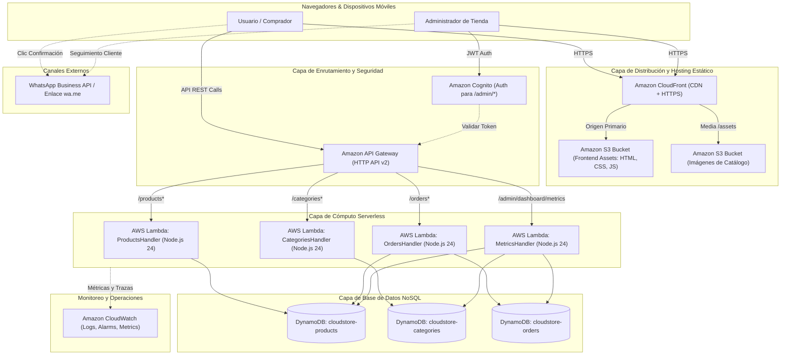

# CloudStore Serverless — Blueprint de Arquitectura AWS

Este documento describe la arquitectura de referencia serverless en **Amazon Web Services (AWS)** diseñada para soportar el frontend de **CloudStore** en su fase productiva.

---

## 1. Diagrama de Arquitectura Global



---

## 2. Descripción de Componentes Serverless

### 1. Amazon S3 (Simple Storage Service)
- **Bucket 1: `cloudstore-frontend-<account-id>`**:
  - Aloja todo el contenido de la carpeta [`frontend/`](../frontend).
  - Bloqueo de acceso público habilitado (*Block Public Access* = ON).
  - Acceso restringido exclusivamente a través de CloudFront mediante **Origin Access Control (OAC)**.
- **Bucket 2: `cloudstore-media-<account-id>`**:
  - Almacenamiento de imágenes de productos y banners.
  - Soporte para subida mediante URLs prefirmadas (*Presigned URLs*) generadas por la función Lambda de productos.

### 2. Amazon CloudFront
- Distribución global con certificados SSL/TLS gestionados vía **AWS Certificate Manager (ACM)**.
- Políticas de caché:
  - Cache habilitada para archivos estáticos versionados (`.css`, `.js`, imágenes) con `max-age=86400`.
  - Cache deshabilitada o TTL reducido para archivos `.html` (`Cache-Control: no-cache, no-store`).
- Configuración de página de error personalizada: Redirección de errores 404 a `/index.html` con código 200 para navegación fluida.

### 3. Amazon API Gateway (HTTP API)
- Más rápido y económico que REST API tradicional, con soporte nativo para CORS.
- **Configuración CORS requerida:**
  - `Access-Control-Allow-Origin`: `https://cloudstore.tu-dominio.com` (o `*` durante staging).
  - `Access-Control-Allow-Methods`: `GET, POST, PUT, PATCH, DELETE, OPTIONS`.
  - `Access-Control-Allow-Headers`: `Content-Type, Authorization, X-Requested-With`.
- Enrutamiento directo a funciones Lambda mediante integración payload format `2.0`.

### 4. AWS Lambda (Node.js 24)
- Microservicios empaquetados en contenedores o archivos ZIP con arquitectura `arm64` (AWS Graviton) para menor costo y alta eficiencia energética.
- Variables de entorno compartidas:
  - `TABLE_PRODUCTS = cloudstore-products`
  - `TABLE_CATEGORIES = cloudstore-categories`
  - `TABLE_ORDERS = cloudstore-orders`
- Rol de IAM mínimo privilegiado (*Least Privilege Principle*): permisos `dynamodb:GetItem`, `dynamodb:PutItem`, `dynamodb:UpdateItem`, `dynamodb:DeleteItem`, `dynamodb:Query`, `dynamodb:Scan` exclusivamente sobre las tablas de la aplicación.

### 5. Amazon DynamoDB
- Modo On-Demand (`PAY_PER_REQUEST`) para auto-escalado sin necesidad de aprovisionamiento previo.
- Cifrado en reposo habilitado por defecto (*Encryption at Rest* con AWS KMS).
- Point-in-Time Recovery (PITR) activado para respaldos continuos.
- Especificación completa de esquemas e índices en [`dynamodb-schemas.md`](dynamodb-schemas.md).

### 6. Amazon CloudWatch
- Registro centralizado de logs de ejecución de cada función Lambda con retención de 14 o 30 días.
- Alarmas de CloudWatch para métricas de error 5xx en API Gateway y fallos de ejecución en Lambda.

---

## 3. Plan de Transición desde Modo Simulado hacia AWS

El código del frontend ya está preparado arquitectónicamente para el cambio. El procedimiento de activación en producción constará de los siguientes pasos:

1. **Despliegue de Infraestructura**: Ejecutar plantilla de AWS SAM, CDK o Terraform con las tablas de DynamoDB, Lambdas y API Gateway.
2. **Carga Inicial de Datos**: Ejecutar script semilla para poblar las tablas de DynamoDB con las categorías y productos iniciales.
3. **Conmutación en el Frontend**:
   En [`frontend/js/config.js`](../frontend/js/config.js):
   ```javascript
   const CONFIG = {
     USE_MOCK_API: false, // <-- Cambiar a false
     API_BASE_URL: 'https://xyz123.execute-api.us-east-1.amazonaws.com/prod', // <-- URL de API Gateway
     ...
   };
   ```
4. **Sincronización a S3**:
   ```bash
   aws s3 sync frontend/ s3://cloudstore-frontend-<account-id>/ --delete
   ```
5. **Invalidación de CloudFront**:
   ```bash
   aws cloudfront create-invalidation --distribution-id <DIST_ID> --paths "/*"
   ```
